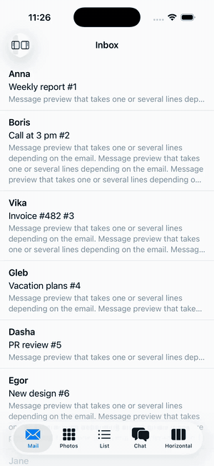
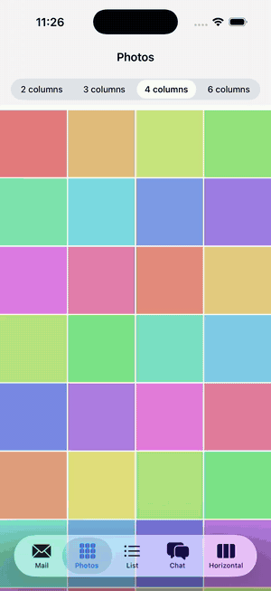

<h1 align="center">SwipeSelect for SwiftUI</h1>

<p align="center">
  <b>Swipe to multi-select for SwiftUI lists and grids.</b><br>
  Hold, drag your finger, and every item under it gets selected. The list auto-scrolls at the edges.
</p>

<p align="center">
  
  
  <a href="https://github.com/Mironlive/swipe-select-swiftui/blob/main/LICENSE"></a>
</p>

<p align="center">
  
  &nbsp;
  
</p>

<p align="center">English · <a href="https://github.com/Mironlive/swipe-select-swiftui/blob/main/README.ru.md">Русский</a></p>

- **Works with what you have.** `ScrollView` + `LazyVStack` / `LazyVGrid` / `LazyHStack`, and `List`. Items of any size.
- **Three ways to start, combinable:** an edge strip (Mail), long press (Photos, Gmail), swipe across (Photos in select mode).
- **Feels native.** Auto-scroll ramps up towards the edge. Moving back restores what was there before the gesture.
- **Taps stay yours.** A tap in the strip goes to your checkbox, a drag goes to the gesture. Scrolling outside the strip is untouched.
- **Plays well with your state.** `onChange` fires once per gesture.
- **No dependencies.** One Swift package, iOS 15+.

> Also available for [React Native](https://github.com/Mironlive/swipe-select) and [Flutter](https://pub.dev/packages/swipe_select).

## Installation

Xcode → File → Add Package Dependencies… →

```
https://github.com/Mironlive/swipe-select-swiftui
```

Or in `Package.swift`:

```swift
.package(url: "https://github.com/Mironlive/swipe-select-swiftui", from: "0.1.0")
```

## Quick start

```swift
import SwiftUI
import SwipeSelect

struct Inbox: View {
    let mails: [Mail]
    @StateObject private var selection = SwipeSelectController<Mail.ID>()

    var body: some View {
        ScrollView {
            LazyVStack(spacing: 0) {
                ForEach(Array(mails.enumerated()), id: \.element.id) { index, mail in
                    MailRow(mail: mail, selected: selection.isSelected(mail.id)) {
                        selection.toggle(mail.id)
                    }
                    .swipeSelectItem(index)
                }
            }
        }
        .swipeSelect(selection, count: mails.count, id: { mails[$0].id })
    }
}
```

Three rules:

1. Put `.swipeSelect(...)` on the `ScrollView` or `List` and pass the number of items.
2. Put `.swipeSelectItem(index)` on **every item** — that's how the package knows where items are.
3. `id` returns a stable id. The selection holds ids, so it survives sorting and pagination.

By default you tap the first checkbox to enter selection mode, then drag along the 56 pt strip on the leading edge.

## How the gesture starts — `activation`

```swift
// Edge strip (default). Like Mail.
activation: [.edge(side: .leading, width: 56)]

// Long press anywhere on an item. Like Photos. No selection mode needed.
activation: [.longPress(duration: 0.3)]

// Swipe across the list. Like Photos in select mode: sideways selects, vertical scrolls.
activation: [.pan()]
```

| | `edge` | `longPress` | `pan` |
| --- | --- | --- | --- |
| Where | strip at the edge | the whole item | the whole item |
| Starts | when the finger moves | after holding | on a swipe across the list |
| Default `when` | `.selectionMode` | `.always` | `.selectionMode` |
| Scrolling | outside the strip | until the hold | along the list |

`when`: `.always`, `.selectionMode` (only while selecting) or `.idle` (only outside selection mode).

### Combine them

Like Mail — no checkboxes at first, a long press anywhere enters selection mode, then you drag along the checkbox column:

```swift
activation: [.longPress(when: .idle), .edge()]
```

A photo grid without a "Select" button:

```swift
activation: [.longPress(when: .idle), .pan()]
```

**Selection mode** is on while something is selected. If your app has a "Select" button, set `selection.selectionMode = true`. Hiding checkboxes outside selection mode is your UI: `selection.isSelectionMode`.

## Your own state

```swift
let selection = SwipeSelectController<String>(selection: store.selectedIDs) { ids, reason in
    store.setSelected(ids)
}

// When your store changes from the outside:
selection.sync(store.selectedIDs) // no onChange call
```

- During a gesture the controller publishes every change (rows update live), but `onChange` fires **once**, when the gesture ends.
- `toggle`, `select`, `deselect`, `setSelection`, `clear` also call `onChange`; `reason` tells you why: `.gesture`, `.toggle` or `.api`.

## Lists

| | |
| --- | --- |
| `ScrollView` + `LazyVStack` / `VStack` | works as is |
| `List` | works as is |
| `LazyVGrid` | selection is linear by index, like in Photos |
| `ScrollView(.horizontal)` + `LazyHStack` | works as is; the edge strip runs along the top / bottom |
| Chats (`.defaultScrollAnchor(.bottom)`) | works as is |
| Right-to-left | `.leading` follows the layout direction |

## Customization

```swift
.swipeSelect(
    selection,
    count: mails.count,
    id: { mails[$0].id },
    activation: [.longPress(when: .idle), .edge(side: .trailing)],
    autoScroll: SwipeSelectAutoScroll(edgeSize: 80, minSpeed: 150, maxSpeed: 1400), // or .disabled
    isEnabled: !isEditing,
    isSelectable: { !mails[$0].locked },                 // skipped while swiping
    onDragStart: { _ in UIImpactFeedbackGenerator(style: .medium).impactOccurred() },
    onItemEnter: { _ in UISelectionFeedbackGenerator().selectionChanged() },
    onDragEnd: { event in print(event.selected) }
)
```

The package draws nothing: checkboxes, highlights, counters and toolbars are yours. Use `selection.isSelectionMode`, `selection.isDragging`, `selection.count`, and `selection.autoScrollDirection` (-1, 0, 1) to highlight the edge while the list auto-scrolls.

## API

### `.swipeSelect(_:count:id:activation:autoScroll:isEnabled:isSelectable:onDragStart:onItemEnter:onDragEnd:)`

| Parameter | Type | Default | |
| --- | --- | --- | --- |
| `_` | `SwipeSelectController<ID>` | — | holds the selection |
| `count` | `Int` | — | number of items |
| `id` | `(Int) -> ID?` | — | stable id of an item |
| `activation` | `[SwipeSelectActivation]` | `[.edge()]` | how the gesture starts |
| `autoScroll` | `SwipeSelectAutoScroll` | `(60, 120, 900)` | edge zone pt, min / max speed pt/s |
| `isEnabled` | `Bool` | `true` | turn the gesture off |
| `isSelectable` | `((Int) -> Bool)?` | all | non-selectable items are skipped |
| `onDragStart` / `onItemEnter` / `onDragEnd` | `(SwipeSelectEvent<ID>) -> Void` | — | index, id, mode (`.select` / `.deselect`), selection |

### `SwipeSelectController<ID>`

`selected`, `count`, `isSelected(_:)`, `isSelectionMode`, `selectionMode` (force on / off), `isDragging`, `autoScrollDirection`, `toggle`, `select`, `deselect`, `setSelection`, `clear`, `sync`, `onChange`.

## How it works

- Every `.swipeSelectItem` reports its frame. Under the finger, the package checks the frames of the items on screen — any size, grids, gaps (the nearest item wins). Lazy stacks stay lazy.
- The gesture is a set of UIKit recognizers on the `UIScrollView` behind your `ScrollView` / `List`. The list's own pan waits for the strip / swipe-across to decide; long press runs alongside scrolling until the hold completes.
- Selection is a transition between ranges `[anchor...finger]`: entering the range applies the mode, leaving it restores the snapshot taken when the gesture started. Only the difference between ranges is touched.
- Auto-scroll runs on a `CADisplayLink` and moves `contentOffset` directly.

## Limitations

- Index order must match visual order (regular lists and grids).
- One `.swipeSelect` per scroll view; scrollables nested inside items aren't supported.
- Lists flipped with `.scaleEffect(y: -1)` aren't supported — use `.defaultScrollAnchor(.bottom)` for chats.

## Example

[`Example/`](https://github.com/Mironlive/swipe-select-swiftui/tree/main/Example) — open `Example/SwipeSelectExample.xcodeproj`. Five tabs: mail (long press → checkboxes, left / right strip), photo grid (10,000 items, 2–6 columns), `List` with locked items, chat, horizontal list.

## Author

Made by Mironov · [@Mironlive](https://github.com/Mironlive)

## License

MIT
