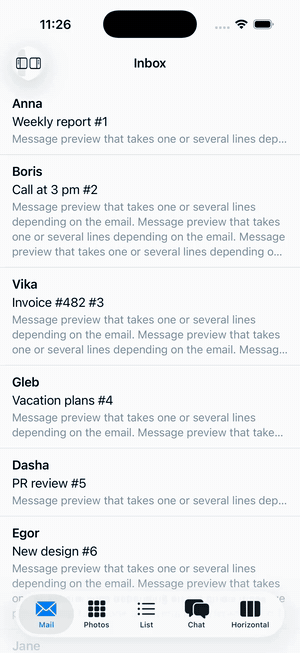
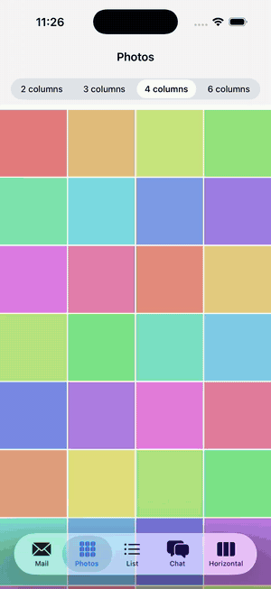

<h1 align="center">SwipeSelect for SwiftUI</h1>

<p align="center">
  <b>Множественный выбор свайпом для списков и сеток SwiftUI.</b><br>
  Зажми, веди пальцем — всё, что под ним, выбирается. У краёв список прокручивается сам.
</p>

<p align="center">
  
  
  <a href="https://github.com/Mironlive/swipe-select-swiftui/blob/main/LICENSE"></a>
</p>

<p align="center">
  
  &nbsp;
  
</p>

<p align="center"><a href="https://github.com/Mironlive/swipe-select-swiftui#readme">English</a> · Русский</p>

- **Работает с тем, что у тебя уже есть.** `ScrollView` + `LazyVStack` / `LazyVGrid` / `LazyHStack` и `List`. Элементы любого размера.
- **Три способа начать, можно комбинировать:** полоса у края (Почта), долгое нажатие (Фото, Gmail), свайп поперёк (Фото в режиме выбора).
- **Как в системе.** Автоскролл ускоряется к краю. Если вести палец назад, возвращается то, что было до жеста.
- **Тапы остаются твоими.** Тап в полосе попадает в твой чекбокс, протяжка — в жест. Скролл вне полосы не трогается.
- **Дружит с твоим стейтом.** `onChange` вызывается один раз за жест.
- **Без зависимостей.** Один Swift-пакет, iOS 15+.

> Есть версии для [React Native](https://www.npmjs.com/package/@mironlive/react-native-swipe-select), [Flutter](https://pub.dev/packages/swipe_select) и [Jetpack Compose](https://github.com/Mironlive/swipe-select-compose).

## Установка

Xcode → File → Add Package Dependencies… →

```
https://github.com/Mironlive/swipe-select-swiftui
```

Или в `Package.swift`:

```swift
.package(url: "https://github.com/Mironlive/swipe-select-swiftui", from: "0.1.0")
```

## Быстрый старт

```swift
import SwiftUI
import SwipeSelect

struct Inbox: View {
    let mails: [Mail]
    @StateObject private var selection = SwipeSelectController<Mail.ID>()

    var body: some View {
        ScrollView {
            LazyVStack(spacing: 0) {
                ForEach(Array(mails.enumerated()), id: \.element.id) { index, mail in
                    MailRow(mail: mail, selected: selection.isSelected(mail.id)) {
                        selection.toggle(mail.id)
                    }
                    .swipeSelectItem(index)
                }
            }
        }
        .swipeSelect(selection, count: mails.count, id: { mails[$0].id })
    }
}
```

Три правила:

1. Повесь `.swipeSelect(...)` на `ScrollView` или `List` и передай число элементов.
2. Повесь `.swipeSelectItem(index)` на **каждый элемент** — так пакет знает, где они.
3. `id` возвращает стабильный id. Выбор хранит id, поэтому переживает сортировку и пагинацию.

По умолчанию: тапаешь первый чекбокс — включается режим выбора, дальше ведёшь по полосе 56 pt у левого края.

## Как начинается жест — `activation`

```swift
// Полоса у края (по умолчанию). Как в Почте.
activation: [.edge(side: .leading, width: 56)]

// Долгое нажатие на элемент. Как в Фото. Режим выбора не нужен.
activation: [.longPress(duration: 0.3)]

// Свайп поперёк списка. Как в Фото: вбок — выбор, вертикально — скролл.
activation: [.pan()]
```

| | `edge` | `longPress` | `pan` |
| --- | --- | --- | --- |
| Где | полоса у края | весь элемент | весь элемент |
| Старт | когда палец сдвинулся | после удержания | при свайпе поперёк |
| `when` по умолчанию | `.selectionMode` | `.always` | `.selectionMode` |
| Скролл | вне полосы | до удержания | вдоль списка |

`when`: `.always`, `.selectionMode` (только в режиме выбора) или `.idle` (только вне его).

### Комбинации

Как в Почте: сначала чекбоксов нет, долгое нажатие включает режим выбора, дальше ведёшь по колонке чекбоксов:

```swift
activation: [.longPress(when: .idle), .edge()]
```

Сетка фото без кнопки «Выбрать»:

```swift
activation: [.longPress(when: .idle), .pan()]
```

**Режим выбора** включён, пока что-то выбрано. Если в приложении есть кнопка «Выбрать», ставь `selection.selectionMode = true`. Прятать чекбоксы вне режима — твой UI: `selection.isSelectionMode`.

## Свой стейт

```swift
let selection = SwipeSelectController<String>(selection: store.selectedIDs) { ids, reason in
    store.setSelected(ids)
}

// Когда стор поменялся снаружи:
selection.sync(store.selectedIDs) // onChange не вызывается
```

- Во время жеста контроллер публикует каждое изменение (строки обновляются вживую), а `onChange` вызывается **один раз** — в конце жеста.
- `toggle`, `select`, `deselect`, `setSelection`, `clear` тоже вызывают `onChange`; `reason` — причина: `.gesture`, `.toggle` или `.api`.

## Списки

| | |
| --- | --- |
| `ScrollView` + `LazyVStack` / `VStack` | работает как есть |
| `List` | работает как есть |
| `LazyVGrid` | выбор линейный по индексу, как в Фото |
| `ScrollView(.horizontal)` + `LazyHStack` | работает; полоса идёт вдоль верха / низа |
| Чаты (`.defaultScrollAnchor(.bottom)`) | работает как есть |
| Справа налево | `.leading` следует направлению текста |

## Настройка

```swift
.swipeSelect(
    selection,
    count: mails.count,
    id: { mails[$0].id },
    activation: [.longPress(when: .idle), .edge(side: .trailing)],
    autoScroll: SwipeSelectAutoScroll(edgeSize: 80, minSpeed: 150, maxSpeed: 1400), // or .disabled
    isEnabled: !isEditing,
    isSelectable: { !mails[$0].locked },                 // пропускаются при свайпе
    onDragStart: { _ in UIImpactFeedbackGenerator(style: .medium).impactOccurred() },
    onItemEnter: { _ in UISelectionFeedbackGenerator().selectionChanged() },
    onDragEnd: { event in print(event.selected) }
)
```

Пакет ничего не рисует: чекбоксы, подсветка, счётчики и тулбары — твои. Есть `selection.isSelectionMode`, `selection.isDragging`, `selection.count` и `selection.autoScrollDirection` (-1, 0, 1) — подсветить край во время автоскролла.

## API

### `.swipeSelect(_:count:id:activation:autoScroll:isEnabled:isSelectable:onDragStart:onItemEnter:onDragEnd:)`

| Параметр | Тип | По умолчанию | |
| --- | --- | --- | --- |
| `_` | `SwipeSelectController<ID>` | — | хранит выбор |
| `count` | `Int` | — | число элементов |
| `id` | `(Int) -> ID?` | — | стабильный id элемента |
| `activation` | `[SwipeSelectActivation]` | `[.edge()]` | как начинается жест |
| `autoScroll` | `SwipeSelectAutoScroll` | `(60, 120, 900)` | зона у края pt, мин / макс скорость pt/s |
| `isEnabled` | `Bool` | `true` | выключить жест |
| `isSelectable` | `((Int) -> Bool)?` | все | невыбираемые пропускаются |
| `onDragStart` / `onItemEnter` / `onDragEnd` | `(SwipeSelectEvent<ID>) -> Void` | — | индекс, id, режим (`.select` / `.deselect`), выбор |

### `SwipeSelectController<ID>`

`selected`, `count`, `isSelected(_:)`, `isSelectionMode`, `selectionMode` (force on / off), `isDragging`, `autoScrollDirection`, `toggle`, `select`, `deselect`, `setSelection`, `clear`, `sync`, `onChange`.

## Как это работает

- Каждый `.swipeSelectItem` сообщает свой фрейм. Под пальцем пакет проверяет фреймы элементов на экране — любой размер, сетки, зазоры (побеждает ближайший). Ленивые стеки остаются ленивыми.
- Жест — набор UIKit-распознавателей на `UIScrollView` под твоим `ScrollView` / `List`. Собственный pan списка ждёт решения полосы / свайпа поперёк; долгое нажатие идёт параллельно скроллу, пока удержание не завершится.
- Выбор — переход между диапазонами `[якорь...палец]`: вошёл в диапазон — применяется режим, вышел — возвращается снимок на начало жеста. Трогается только разница диапазонов.
- Автоскролл крутится на `CADisplayLink` и двигает `contentOffset` напрямую.

## Ограничения

- Порядок индексов должен совпадать с визуальным (обычные списки и сетки).
- Один `.swipeSelect` на скролл; вложенные скроллы внутри элементов не поддерживаются.
- Списки, перевёрнутые через `.scaleEffect(y: -1)`, не поддерживаются — для чатов используй `.defaultScrollAnchor(.bottom)`.

## Пример

[`Example/`](https://github.com/Mironlive/swipe-select-swiftui/tree/main/Example) — открой `Example/SwipeSelectExample.xcodeproj`. Пять вкладок: почта (долгое нажатие → чекбоксы, полоса слева / справа), сетка фото (10 000 элементов, 2–6 колонок), `List` с заблокированными элементами, чат, горизонтальный список.

## Автор

Автор — Миронов · [@Mironlive](https://github.com/Mironlive)

## Лицензия

MIT
